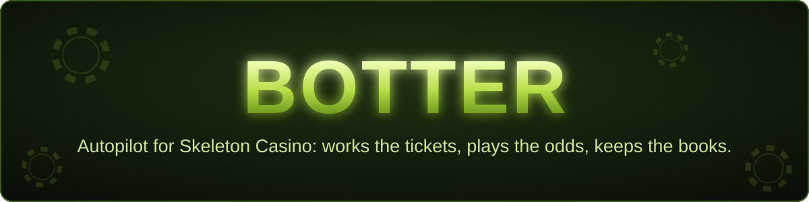
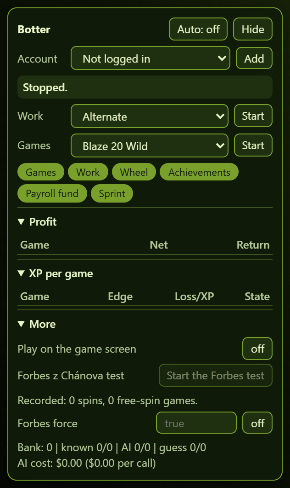
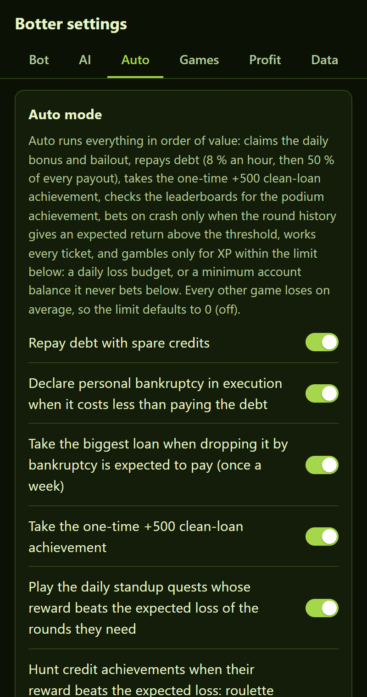
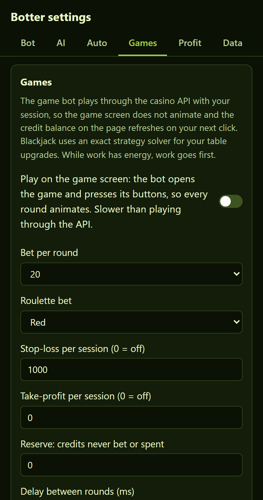
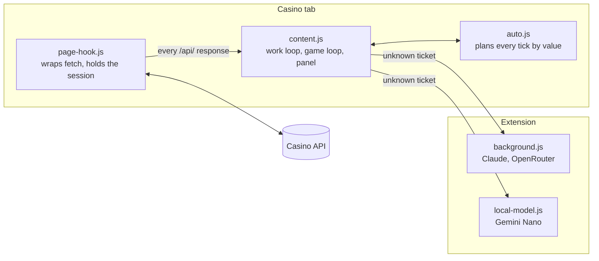

<p align="center">
  
</p>

<p align="center">
  
  
  
  
  
</p>

Botter is a Chrome extension that plays [Skeleton Casino](https://skeleton-casino.jrezab.cz/)
for you. It answers the work tickets, claims every free bonus and only gambles where the
math says it pays, using exact odds models of each game at your account's upgrades.

> Unofficial and not affiliated with the casino. The casino plays for virtual credits only.

<table>
  <tr>
    <td align="center"><br><sub>Panel on the casino page</sub></td>
    <td align="center"><br><sub>Auto mode settings</sub></td>
    <td align="center"><br><sub>Game settings</sub></td>
  </tr>
</table>

## What it does

| | |
| --- | --- |
| **Work** | Solves all four ticket types: bug hunt, "Co to vypíše?", "Založ task" and "Přepiš kód". Every submit response carries the right answer, so the bank learns each ticket the first time it sees it. |
| **AI fallback** | Unknown tickets go to on-device Gemini Nano (free, offline), the Claude API or any OpenRouter model. |
| **Games** | Blaze 20 Wild, Skeleton Slots, Slotingi, Forbes z Chánova, roulette, blackjack, baccarat, Kostky, Case opening, Kniha mrtvého kódu and Hledání bugů, through the API or (for the older games) by pressing the real game screen's buttons. |
| **Auto mode** | One switch. Claims the daily bonus, wheel and bailout, repays debt or declares bankruptcy when that is cheaper, runs the daily standup quests, hunts achievements, plays the lottery when it pays, and grinds XP on the lowest-edge game within a loss budget. |
| **Upgrades** | Buys shop upgrades only when the XP still to grind earns the price back. |
| **Books** | Profit, return and XP per credit for every game, upgrade level and account. Roulette, baccarat, Kostky and Case opening results are checked against the model. |
| **Accounts** | Saves logins, switches without logging out and rotates so every account's energy gets used, every account bets on a Produkce padá round that pays and buys its lottery tickets on random, weighted or your own numbers. |
| **Bundle watch** | Spots a new casino deploy and flags any game table the models copied that changed. |

## How it works



A ticket's answer comes from the **answer bank** first, then the **AI solver**, then an
optional **random guess** (a wrong answer costs energy but still teaches the bank).

The grinder plans with each game's long-run return to player at the account's upgrades,
simulated in `scripts/odds.mjs`, not the noisy measured one:

| Game | Unupgraded | Fully upgraded |
| --- | ---: | ---: |
| Forbes z Chánova (modelled) | ~73 % | ~91 % |
| Kostky (Malá) | 92.4 % | 97.9 % |
| Roulette | 92.3 % | 97.3 % |
| Baccarat (Bankéř) | 90.5 % | 97.8 % |
| Blackjack | 87.6 % | 97.1 % |
| Case opening | 86.9 % | 96.2 % |
| Kniha mrtvého kódu | ~80 % | ~95 % |
| Hledání bugů | 81.8 % | 94.8 % |
| Slotingi | ~74 % | ~93 % |
| Skeleton Slots | ~71 % | ~94 % |
| Blaze 20 Wild | ~63 % | ~94 % |

Forbes z Chánova is modelled from the client's tables (retuned 2026-10-17) plus one rule only the server shows: a reel never holds two scatters (found 2026-10-20). That halves how often free spins start, so it never pays over 100 % and stays below roulette even maxed. Run the Forbes test after an update to check the model again.

Every strategy, formula and setting is described in the [full reference](docs/reference.md).

## Install

1. Open `chrome://extensions`, turn on Developer mode, click **Load unpacked** and pick this folder.
2. Click the extension icon to open the settings in the side panel. Changes save as you make them.
3. For the default on-device AI, press **Download the model** once on the AI tab. For
   Claude or OpenRouter, pick the solver and paste a key.
4. Open the casino, log in and press **Start** in the panel, or turn on **Auto**.

<details>
<summary>On-device model says "not supported"</summary>

Gemini Nano needs Chrome 138+, about 22 GB free disk and a GPU with more than 4 GB VRAM
or 16 GB RAM. If it still refuses, open `chrome://flags`, set **Enables optimization
guide on device** to **Enabled BypassPerfRequirement** and **Prompt API for Gemini Nano**
to **Enabled**, relaunch and press **Download the model** again. Progress shows at
`chrome://on-device-internals`.
</details>

## Run in Docker

The container runs headless Chromium with Botter loaded and serves a dashboard on
port 8080. Sign in there to watch the casino tab live, click and type into it (log in to
the casino, press Start or Auto), open the Botter settings in a tab, and follow the bot's
status and activity log.

```sh
cp .env.example .env        # set DASHBOARD_PASSWORD, 12+ characters
docker compose up -d --build
```

Then open `http://<host>:8080`. Or without compose:

```sh
docker build -t botter .
docker run -d --name botter -p 8080:8080 --shm-size 1g --init \
  -e DASHBOARD_PASSWORD=... -v botter-data:/data botter
```

| Variable | Default | What it does |
| --- | --- | --- |
| `DASHBOARD_USER` | `admin` | Dashboard user name. |
| `DASHBOARD_PASSWORD` | (required) | Dashboard password, at least 12 characters. |
| `TRUST_PROXY` | `0` | `1` behind a reverse proxy: trusts `X-Forwarded-For/-Proto/-Host` for the client IP, the `Secure` cookie and the origin check. |
| `CASINO_URL` | casino address | The page the casino tab opens. |
| `LOG_LEVEL` | `info` | Server log level, JSON lines on stdout. |

- The Chromium profile lives in the `/data` volume, so casino sessions, saved accounts,
  the answer bank, stats and settings survive restarts and image upgrades.
- Gemini Nano does not run in the container. Pick Claude or OpenRouter on the AI tab of
  the settings, or rely on the bank and the random guess.
- Dashboard sessions are kept in memory: restarting the container signs you out, the
  bot itself carries on from the saved profile. Failed sign-ins are limited to 10 per IP
  per 15 minutes.
- Put it behind HTTPS (a reverse proxy with `TRUST_PROXY=1`) before exposing it beyond
  your own network. The dashboard controls a logged-in browser.
- `GET /health` answers without a login for uptime checks.

Server tests: `cd server && npm test`.

## Good to know

- **Never use the casino's Log out to switch accounts.** It revokes every session of that
  account, saved copies included. Use **Add** in the panel instead.
- Use one casino tab per account. For two accounts at once, open the second in an
  incognito window with Botter allowed there.
- API keys stay in `chrome.storage.local` and are sent only to `api.anthropic.com` or
  `openrouter.ai`. Backups (Data tab) leave keys and login sessions out unless you switch
  them in.

## Development

```sh
npm run check
```

That parses every script, checks that the `cs` and `en` locales carry the same keys and
runs the unit tests. There are no dependencies and no build step: after an edit, reload
the extension in `chrome://extensions` and refresh the casino tab.

| Script | What it does |
| --- | --- |
| `node scripts/bundle.mjs [bundle]` | Checks the live casino bundle (or a saved copy) against the tables the models copy. Exits 1 when a model is stale. |
| `node scripts/odds.mjs [spins] [--only game]` | Regenerates `src/odds-table.js` for every game and upgrade combination. About 10 minutes. |
| `node scripts/hotfix-check.mjs <export>...` | Checks the Forbes z Chánova model against rounds exported from the Data tab. |

If the casino UI changes, the selectors the bot relies on are listed at the end of the
[reference](docs/reference.md#development).
