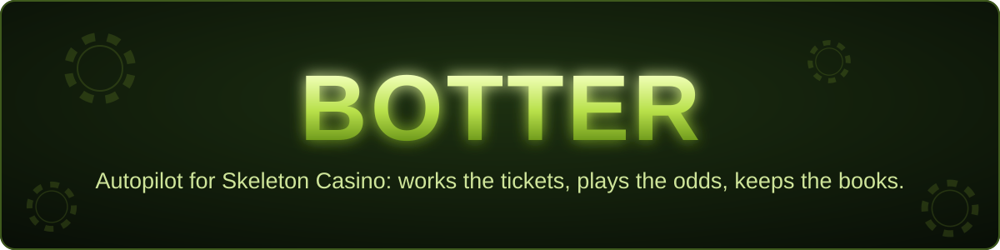
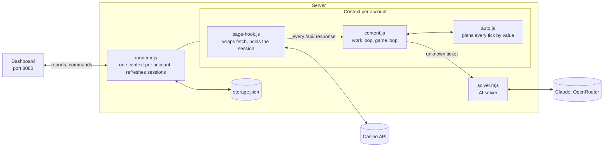

<p align="center">
  
</p>

<p align="center">
  
  
  
  
  
  
</p>

Botter plays [Skeleton Casino](https://skeleton-casino.jrezab.cz/) for you, on a server,
for every saved account at once. It answers the work tickets, claims every free bonus
and only gambles where the math says it pays, using exact odds models of each game at
the account's upgrades. A login-protected dashboard shows every account and controls it.

> Unofficial and not affiliated with the casino. The casino plays for virtual credits only.

## What it does

| | |
| --- | --- |
| **Work** | Solves all four ticket types: bug hunt, "Co to vypíše?", "Založ task" and "Přepiš kód". Every submit response carries the right answer, so the bank learns each ticket the first time it sees it. |
| **AI fallback** | Unknown tickets go to the Claude API or any OpenRouter model, if you add a key. |
| **Games** | Blaze 20 Wild, Skeleton Slots, Slotingi, Forbes z Chánova, roulette, blackjack, baccarat, Kostky, Case opening, Kniha mrtvého kódu and Hledání bugů, all through the casino API. |
| **Auto mode** | One switch per account. Claims the daily bonus, wheel and bailout, repays debt or declares bankruptcy when that is cheaper, runs the daily standup quests, hunts achievements, plays the lottery when it pays, and grinds XP on the lowest-edge game within a loss budget. |
| **Upgrades** | Buys shop upgrades when the XP still to grind earns the price back, and every other upgrade from spare credits. |
| **Šatna** | Buys every wardrobe item from spare credits and wears the most expensive one of each kind, or the one you pick. |
| **Books** | Profit, return and XP per credit for every game, upgrade level and account. Roulette, baccarat, Kostky and Case opening results are checked against the model. |
| **Accounts** | Saves logins and runs every account at once, each with its own Auto, Work and Games switches. Every account bets on a Produkce padá round that pays and buys its lottery tickets on random, weighted or your own numbers. |
| **Bundle watch** | Spots a new casino deploy and flags any game table the models copied that changed. |

## How it works



A ticket's answer comes from the **answer bank** first, then the **AI solver**, then an
optional **random guess** (a wrong answer costs energy but still teaches the bank).

The grinder plans with each game's long-run return to player at the account's upgrades,
simulated in `scripts/odds.mjs`, not the noisy measured one:

| Game | Unupgraded | Fully upgraded |
| --- | ---: | ---: |
| Forbes z Chánova (modelled) | ~73 % | ~91 % |
| Kostky (Malá) | 92.4 % | 97.9 % |
| Roulette | 92.3 % | 97.3 % |
| Baccarat (Bankéř) | 90.5 % | 97.8 % |
| Blackjack | 87.6 % | 97.1 % |
| Case opening | 86.9 % | 96.2 % |
| Kniha mrtvého kódu | ~80 % | ~95 % |
| Hledání bugů | 81.8 % | 94.8 % |
| Slotingi | ~74 % | ~93 % |
| Skeleton Slots | ~71 % | ~94 % |
| Blaze 20 Wild | ~63 % | ~94 % |

Forbes z Chánova is modelled from the client's tables (retuned 2026-10-17) plus one rule only the server shows: a reel never holds two scatters (found 2026-10-20). That halves how often free spins start, so it never pays over 100 % and stays below roulette even maxed. Run the Forbes test after an update to check the model again.

Every strategy, formula and setting is described in the [full reference](docs/reference.md).

## Install

Botter runs on a server, in Docker:

```sh
cp .env.example .env        # set DASHBOARD_PASSWORD, 12+ characters
docker compose up -d --build
```

Or without Docker, on Node 22 or later (data goes to `server/.data`):

```sh
cd server && DASHBOARD_PASSWORD='at-least-12-chars' npm start
```

Open `http://<host>:8080`, sign in, then:

1. **Add the accounts.** Sign them in on the Accounts tab (see below), or import a
   backup in Settings, Data and backup.
2. **Pick a solver.** Under Settings, AI solver, choose Claude or OpenRouter and paste a
   key, or leave it off and rely on the bank and the random guess.
3. **Turn on Auto** for each account in the account strip or the Overview's Bot controls,
   or press **Auto on every account**.

## The server

The server runs the bot scripts (`page-hook.js`, `content.js` and the game modules) in
Node, one context per saved account, all at once. Each context is pinned to its account
and has its own localStorage (session, pacing, learned speeds), so every account works,
grinds and claims on its own. Work tickets go straight to `/api/work/start` and
`/api/work/submit`, games go through the API, and the server refreshes each Supabase
session. Auto, Work, Games, the ticket type and the game are set per account; every other
setting is shared.

The dashboard on port 8080 has an account strip and eight tabs. The strip shows a card per
account (status, level, credits, energy, XP to the next level and to 40) with its own
**Auto** switch, and a button that turns Auto on or off for every account.

- **Overview**: **Live play** shows every round, ticket, wheel spin, level-up, reward and
  other action of every account as it happens (the roulette pocket, dice, baccarat and
  blackjack cards, slot reels, the mines board, the case item, with the bet, net and XP),
  plus each account's rounds a minute, net and XP over the last 5 minutes, in one column
  per account. **Bot controls** has a row per account: Auto, Work with the ticket type and
  Games with the game (the manual switches are off while Auto runs). **Account books**
  shows one account's profit since its last výpověď, XP per game, upgrade queue, the
  Forbes z Chánova test and the answer counters with AI cost. Next to them sit the loan
  shark card (debt, principal, repaid, a countdown to the next interest tick and the debt
  after it, execution, and why the bot took the loan) and the latest activity.
- **Progress** charts the level and credits of every account over time.
- **Statistics**: Profit (per account or summed, and per upgrade level), Model checks
  (roulette, baccarat, Kostky and Case opening), Levels, Server speed and Odds.
- **Leaderboards** shows the casino's six boards (sprint with its countdown and last
  podium, level, net worth, biggest win, losers, debtors), fetched with the bot's session
  and cached for a minute, with every saved account highlighted.
- **Changes** lists the casino's own changelog, every casino deploy the bot has seen and
  whether its models still match it; a deploy that breaks a model puts a "Botter needs an
  update" banner over every tab.
- **Activity** is the full log.
- **Accounts** lists the saved logins with their live level, výpovědi, credits, energy,
  debt and state (running, set aside, no login), a **Forget** button per account, a
  GitHub sign-in and an e-mail sign-in.
- **Settings**: Work, AI solver, Auto mode, Upgrades, Games, Šatna, and Data and backup.
  Changes save as you make them.

One language switch covers all of it. Every section has its own address, such as
`#settings/auto` or `#stats/profit`.

| Variable | Default | What it does |
| --- | --- | --- |
| `DASHBOARD_USER` | `admin` | Dashboard user name. |
| `DASHBOARD_PASSWORD` | (required) | Dashboard password, at least 12 characters. |
| `BOTTER_PORT` | `8080` | Host port for the dashboard (Docker). |
| `BOT_LOCALE` | `cs` | Starting language (`cs` or `en`); the dashboard's language switch overrides it and is remembered. |
| `TRUST_PROXY` | `0` | `1` behind a reverse proxy: trusts `X-Forwarded-For/-Proto/-Host` for the client IP, the `Secure` cookie and the origin check. |
| `CASINO_URL` | casino address | Casino the bot plays. |
| `LOG_LEVEL` | `info` | Server log level, JSON lines on stdout next to the bot's own. |
| `UPDATE_BRANCH`, `UPDATE_INTERVAL` | `master`, `300` | Branch the updater follows and how often it checks, in seconds. |

- Storage lives in `/data/storage.json` (the `botter-data` volume): settings, bank,
  stats, accounts and each account's localStorage survive restarts and upgrades.
- **Signing in an account** (new, or one whose session ran out): on the Accounts tab
  press **Open GitHub sign-in**. GitHub sends you back to the casino with `?code=` in
  the address bar; paste that whole address into the dashboard. The casino only lets the
  sign-in return to its own address, so the code is carried over by hand, and it works
  once within a few minutes. E-mail accounts use the e-mail form; the password is never
  stored. When no one is logged in, the account strip shows a sign-in button.
- Saved logins and API keys never reach the browser: the dashboard sees a placeholder,
  and the key fields only take a new key.
- **Backups** (Settings, Data and backup) are built and imported on the server. With
  *Include API keys and saved logins* on, the file carries the keys and sessions too.
- An account whose profile fails to load three times in a row is set aside for 30
  minutes; the others carry on.
- **Updates from git:** the `updater` service polls `origin`, fast-forwards the checkout
  and runs `docker compose up -d --build botter` when the branch moves. It mounts the
  Docker socket, which is root on the host, and builds whatever lands on the branch, so
  push access to the repo is code execution on that machine. Remove the service to
  update by hand instead.
- Dashboard sessions are kept in memory: a restart signs you out, the bot carries on.
  Failed sign-ins are limited to 10 per IP per 15 minutes. Put it behind HTTPS (reverse
  proxy, `TRUST_PROXY=1`) before exposing it beyond your own network.
- `GET /health` answers without a login for uptime checks.

## Good to know

- **Never use the casino's Log out** on an account the server runs. It revokes every
  session of that account, including the one the server holds, and the account has to
  be signed in again on the Accounts tab.
- Do not play a saved account in a browser at the same time. Every refresh rotates the
  session's refresh token, so the browser and the server on one login log each other out.
- API keys are sent only to `api.anthropic.com` or `openrouter.ai`. Backups leave keys
  and login sessions out unless you switch them in.

## Development

```sh
npm run check
cd server && npm test
```

`npm run check` parses every script (the bot, `server/src` and `server/public`), checks
that the `cs` and `en` locales carry the same keys and that every key the code and the
dashboard use exists, and runs the unit tests. There are no dependencies and no build
step: restart the server (or let the updater rebuild the container) after an edit.

| Script | What it does |
| --- | --- |
| `node scripts/bundle.mjs [bundle]` | Checks the live casino bundle (or a saved copy) against the tables the models copy. Exits 1 when a model is stale. |
| `node scripts/odds.mjs [spins] [--only game]` | Regenerates `src/odds-table.js` for every game and upgrade combination. About 10 minutes. |
| `node scripts/hotfix-check.mjs <export>...` | Checks the Forbes z Chánova model against rounds exported from Settings, Data and backup. |

The casino API calls the bot relies on are described in the
[reference](docs/reference.md#development).
